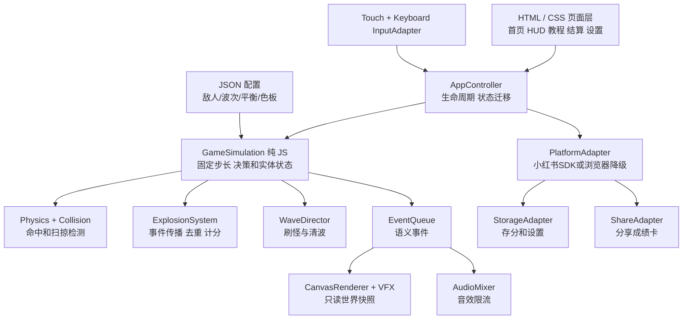
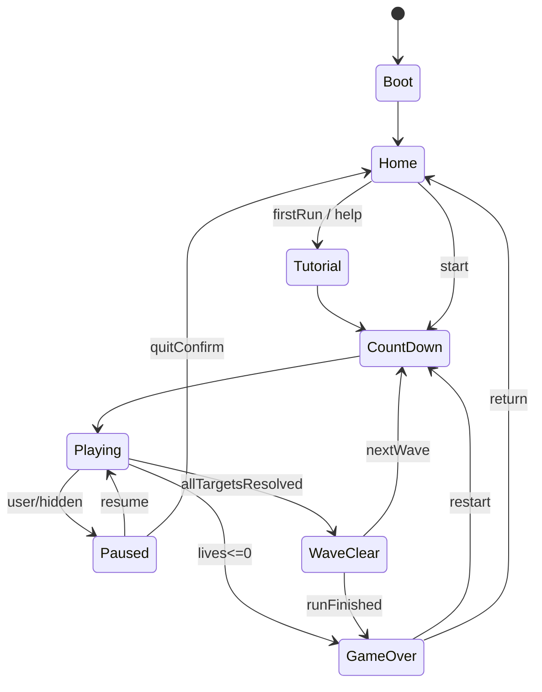

# 「深海猎杀」——小红书小工具游戏技术设计文档（TDD）v1.0

- **日期**：2026-10-11
- **状态**：初始研发设计基线；最新十波、五类潜艇、道具/计分/声音与表现扩展以 [06号实施补充](docs/06_十波扩展与体验增强.md) 及 [07号首版补充](docs/07_存档勋章与首版补充.md) 为准；未经过小红书真机验证。
- **上游需求**：`WinDepth_PRD.md`
- **资料核验**：`docs/03_原作考证_来源及待核验清单.md`
- **角色分工**：Claude Code 制定和维护设计/任务计划；Codex 审查后编写/修改代码、测试；用户对体验、视觉和关键路线作批准。

> **最高优先级规则**：游戏逻辑必须脱离平台容器和视觉渲染独立运行；参数与规则可确定性回放；原作缺失的细节不伪装成“历史还原”；任何平台桥接不成功都不能拖垮离线主流程。

---

## 1. 技术目标、环境与决策

### 1.1 最小目标
- 用普通 Web 技术实现 **移动竖屏优先的离线 2D 街机游戏**：HTML/CSS UI + Canvas 2D 主战斗区 + JS 游戏模拟。
- 5 波 MVP 支持完整生命周期、3 类潜艇、玩家船、深水炸弹、鱼雷、范围连爆、连锁得分、最高分、本机设置、暂停/继续、游戏结束和重开。
- 无网络 API、不联网、无需登录、单 ZIP 部署。
- 本地浏览器与小红书容器共用同一份游戏模拟与主要 UI，差异仅由平台适配层处理。

### 1.2 明确不采用
- **不使用 Unity/Unreal**；目标是轻量 H5 游戏，不需要 3D 编辑器或重量级运行时。
- 首版不使用 WebGL、WASM、Worker、Service Worker、后端数据库或 CDN。容器限制与适配成本不值得。
- 不使用源自原作的图像、音频、代码、可执行文件；仅用于研究参考，除非权利人明确授权。
- 不接受“把所有逻辑写进一个 5000 行 game.js”作为后期可维护方案。
- 不在 CSS 层用 transform 移动敌人而又在另一坐标系里做判定。

### 1.3 工具栈（建议，未锁版本）
| 目标 | 工具与说明 |
|---|---|
| 核心语言 | JavaScript ES2017 构建目标；开发态可用 TypeScript，但构建后需为普通经典脚本，不带 module/import/export |
| UI | HTML/CSS，固定底部控制栏；菜单/HUD 尽可能 DOM，战斗渲染用 Canvas 2D |
| 项目模板 | `create-xhs-minitool` 脚手架可作候选；引入前先对其当前输出做平台规范审查 [P03] |
| 构建 | Vite 或脚手架构建链；输出静态 JS/CSS + 根目录 `index.html`；避免运行时外链依赖 |
| 自动化测试 | Node 内置测试运行器或 Vitest（只在开发环境使用，构建不携带测试依赖） |
| UI验证 | 本地浏览器自动化截图 + 人工实机；如测试工具依赖浏览器，仅开发机使用 |
| 源码管理 | Git + 小型 feature 分支 + diff review；禁止第三方遥测及密钥入库 |

平台最小兼容基线与精确打包条件，应以发布当日官方上传页和维护版规范为准。社区维护文档记录 Android 8.1 / Chrome 61、JS ES2017 最低基线，不据此保证所有真实设备均可用。[P02][P04]

---

## 2. 分层架构与依赖方向



**约束**：依赖单向；`Simulation` 不导入 DOM、window、xhs、Canvas、AudioContext 或 Date.now；渲染不直接修改实体状态；平台 SDK 不被敌人/计分系统调用。测试可只实例化纯逻辑游戏引擎。

### 2.1 模块清单与接口职责
| 模块 | 输入 | 输出 | 不应做 |
|---|---|---|---|
| `AppController` | 页面动作、SDK 探测、simulation events | 状态切换、页面更新 | 判定攻击碰撞 |
| `InputAdapter` | 指针/键盘事件 | `{moveAxis, firePressed, pausePressed}` | 决定炸弹伤害 |
| `Simulation` | step(dt, input)、seed、配置 | `worldState` + 语义事件 | Canvas draw、直接存储 |
| `PlayerSystem` | moveAxis、世界尺寸 | 战舰位置/生命/无敌状态 | UI 文字或分享 |
| `ProjectileSystem` | 射击命令、位置、冷却 | 炸弹/鱼雷实体 | 更改 HTML |
| `CollisionSystem` | 实体快照/移动段 | 碰撞事件，稳定排序 | 爆炸视觉 |
| `ExplosionSystem` | hit events、位置、类型、链ID | 伤害、连锁事件、分数事件 | 创建粒子 DOM |
| `WaveDirector` | 时间、存活数/死亡数 | 刷新敌人、波次进度 | 修改 SDK |
| `Renderer` | 上一帧/当前帧 + 插值 | Canvas 画面 | 变更实际分数 |
| `VFX/Audio` | 语义事件 | 可丢弃的表现对象 | 参与碰撞结果 |
| `PlatformAdapter` | 能力检测/分享/存储请求 | 成功/失败状态 | 参与游戏物理模拟 |

### 2.2 推荐仓库结构（供 Codex 评审后创建）

```text
windepth-xhs/
├─ index.html                     # 开发入口；build 后位于 zip 根
├─ package.json
├─ vite.config.*                  # 仅开发构建使用，不进 zip
├─ .agents/skills/                # 官方/维护版规范；开发用途
├─ src/
│  ├─ main.js
│  ├─ app/AppController.js
│  ├─ app/GameStates.js
│  ├─ core/Simulation.js
│  ├─ core/Clock.js
│  ├─ core/Random.js
│  ├─ core/EntityStore.js
│  ├─ systems/PlayerSystem.js
│  ├─ systems/ProjectileSystem.js
│  ├─ systems/EnemySystem.js
│  ├─ systems/CollisionSystem.js
│  ├─ systems/ExplosionSystem.js
│  ├─ systems/ScoringSystem.js
│  ├─ systems/WaveDirector.js
│  ├─ input/InputAdapter.js
│  ├─ render/CanvasRenderer.js
│  ├─ render/ParticlePool.js
│  ├─ render/SpriteAtlas.js
│  ├─ audio/AudioMixer.js
│  ├─ platform/PlatformAdapter.js
│  ├─ platform/StorageAdapter.js
│  ├─ platform/ShareAdapter.js
│  ├─ config/game-balance.json
│  ├─ config/waves.json
│  ├─ css/main.css
│  └─ assets/                     # 原创图片等允许类型
├─ tests/unit/
├─ tests/integration/
├─ tests/snapshots/
├─ scripts/                       # 包体审计、静态资源审查
├─ docs/                          # PRD/TDD/参考清单、测试报告
└─ dist/                          # 静态发布文件，不包含构建脚本
```

**关于音频资源**：维护版 ZIP 白名单列出 html/css/js、图片、woff/woff2、json 等，但**没有把 mp3/wav 明确列为 ZIP 可接受类型**。首版使用 Web Audio API 动态合成音效（需手势解锁、实机验证），不要未经确认直接塞 mp3/wav 到 ZIP。若官方白名单后续更新，再考虑离线音频文件。[P02]

---

## 3. 坐标系、视窗与响应式

### 3.1 世界空间 vs 屏幕像素
- 游戏物理逻辑采用固定世界尺寸：建议 **1000×1200 世界单位（WU）**，`x∈[0,1000]`，`y∈[0,1200]`（下为正）。世界尺寸仅是**原创工程参数**。
- 海平面位置建议 `y=155 WU`；海下主体深度从 `155` 延伸至 `1200`。数据不写死在碰撞算法中。
- 每种屏幕尺寸按 `worldToCanvas` 映射，并支持 `canvasToWorld` 逆变换：`screen = world*scale + offset`；**强制保持 x/y 等比**，禁止拉伸变形。
- 超窄竖屏可在垂直高度裁切远景背景、调整 CSS 外框，但**不能随意裁掉敌人的活动区**。如果世界长宽比不匹配：选择等比缩放 + 背景填充 + 控制区重分配；不得改变实际潜艇速度。
- Canvas backing store = CSS 尺寸 × `min(devicePixelRatio, qualityDprCap)`；DPR 上限初始 2.0（设计值），掉帧再降到 1.5/1.0，逻辑物理坐标保持不变。

### 3.2 竖屏可用性需要技术实验
原作是一屏横向移动射击游戏，竖屏缩窄可能显著改变“提前量”操作。M0/M1 必须做两种对比：
1. **方案 A**：统一世界坐标并缩放宽度，使整幅海域可见，潜艇看起来较小。
2. **方案 B**：重新设计更紧凑的世界宽高比，同时同步调校船/潜艇速度，确保同样的投弹反应窗。

验收指标不是像素相同，而是：首关敌人宽度足够辨识、关键投弹提前量可以看清、单指/双指操作无障碍。不建议引入横向镜头跟随，除非竖屏测试证明无法兼容固定镜头；摄像机移动会大幅提高判定感知难度。

### 3.3 安全区与布局
采用 DOM 外壳包住画布：`<main class="app">` 内部为顶栏、战斗画布、控制条；CSS `height: 100vh` 与可检测的 viewport 实际尺寸搭配，支持 safe-area padding；在平台原生导航与 WebView 安全区前提下进行实际调校。Android/iOS 都应记录“系统/APP 顶栏占多少 CSS px”，不能假定零。

### 3.4 触控事件模型
- 仅控制区捕获指针，不让战斗区处理点射敌人。
- 输入语义不是一个单独的 currentButton；允许 `moveAxis=-1, fireHeld=true` 同时出现。
- 对 `pointerdown` `pointerup` `pointercancel` 和浏览器 `blur`、`visibilitychange` 做完整释放；支持多 pointerId 管理。
- 长按左 + 点击投弹不释放左；切出应用要自动暂停。
- 可配置是否连续投弹：MVP 采用**按住投弹按照冷却自动连发**，首轮试玩再决定是否调整为每次点击单发。自动连发的原版真实性未知，属于产品设计值。
- 手指从左键划到右键，必须先解除旧方向，不能叠加两方向死锁。

---

## 4. 固定步长游戏主循环（重点）

### 4.1 原则
`requestAnimationFrame` 调用时间不稳定，不能将每帧位移写为固定常量。使用**固定步长模拟 + 可变帧率渲染**：

- 逻辑帧率建议 60Hz，`FIXED_DT = 1/60` 秒。
- 一帧最大补算步数限制 5（防止后台恢复时 spiraling），超过的累计时间丢弃并记录调试提示。
- `maxFrameTime = 0.25秒`，背景暂停时清空 accumulator。
- 运行速度不得绑定渲染 FPS。30fps 渲染时，每次可能执行 2 次逻辑更新。

```js
// 简化伪代码（仅描述算法；不得省略状态/平台边界）
const STEP = 1 / 60;
let accumulator = 0;
let lastMs = undefined;
function tick(nowMs) {
  if (lastMs === undefined) lastMs = nowMs;
  const elapsed = Math.min((nowMs - lastMs) / 1000, 0.25);
  lastMs = nowMs;
  if (game.isRunning()) {
    accumulator += elapsed;
    let steps = 0;
    while (accumulator >= STEP && steps < 5) {
      game.simulation.step(STEP, input.consumeForStep());
      accumulator -= STEP;
      steps++;
    }
    if (steps === 5 && accumulator >= STEP) accumulator = 0;
  } else {
    accumulator = 0;
  }
  game.renderer.draw(game.simulation.snapshot(), accumulator / STEP);
  requestAnimationFrame(tick);
}
```

**关键实现细节**：`firePressed` 属于边沿事件，不能在补算多步时重复消费；若要连续开火，应由模拟冷却和 `fireHeld` 控制。输入队列按时间戳/采样步处理，避免 30fps 时一个点击被算成两发。

### 4.2 随机数与可回放
- 同局创建 `runSeed`。所有敌人生成位置、运动变体、鱼雷时机使用固定 PRNG（如 xorshift32，明确 32 位溢出语义）而非 `Math.random`；若视觉泡沫随机可独立 RNG，不进入模拟 seed。
- 每次更新保持实体 ID 单调生成，事件按确定规则排序。
- Replay 仅保留小规模 `{seed, configVersion, inputCommandsByTick}` 开发态文件；不在小工具中录屏或无上限写日志。
- 平衡 JSON 版本变化时，旧 replay 必须声明配置版本，不能拿新配置验证旧结果。

### 4.3 事件系统
**语义事件**（例如）：`BombDropped`、`SubmarineHit`、`ExplosionStarted`、`ChainContinued`、`ShipDamaged`、`WaveCompleted`、`RunEnded`。

- 语义事件可以触发粒子/音效/浮字，但视觉事件掉帧允许丢弃，伤害和分数不允许丢失。
- 同一 gameTick 内为所有命中/爆炸/分数事件生成稳定 eventId，防止渲染重复播放音效。
- 由 UI/音频消费事件后清空；事件最大队列数有上限，最多压缩可丢弃 VFX，不压缩得分事实。

---

## 5. 实体数据结构与状态机

### 5.1 TypeScript 风格接口说明（即使运行态是JS也遵守）

```ts
// 下面是概念接口，不是生产可直接运行的完整实现。
type EntityId = number;
type EntityKind = 'player'|'sub'|'bomb'|'torpedo'|'explosion';
interface BaseEntity {
  id: EntityId; kind: EntityKind;
  x: number; y: number; vx: number; vy: number;
  halfW: number; halfH: number;
  alive: boolean;
}
interface Player extends BaseEntity {
  lives: number; invincibleRemaining: number;
  shotCooldownRemaining: number;
}
interface Submarine extends BaseEntity {
  typeId: string; hp: number; scoreBase: number;
  attackCooldownRemaining: number;
  state: 'spawn'|'sail'|'attack'|'dying'|'despawn';
  lastHitEventId?: number;
}
interface Projectile extends BaseEntity {
  ownerId: EntityId; projectileKind:'depth-charge'|'torpedo';
  damage: number; lifetimeRemaining: number;
}
interface Explosion {
  id: EntityId; x:number; y:number;
  radius:number; maxRadius:number; expansionRate:number;
  lifeRemaining:number; chainId:number; chainDepth:number;
  damagedIds: Set<EntityId>;
}
interface RunState {
  runSeed:number; tick:number; wave:number;
  score:number; maxCombo:number; kills:number;
  ended:boolean;
}
```

### 5.2 总状态机



独立实体状态：`spawn → active → dying → removed`。`dying` 可播放动画，但对碰撞已不再可命中，否则会重复得分；游戏关卡完成看逻辑清理，不等待所有非关键粒子渲染完毕。

### 5.3 生命与无敌期
被鱼雷/水雷命中：立即在模拟层扣 1 生命，生成 `ShipDamaged`，设置无敌期 1.5 秒（设计值）。同 tick 多重攻击只扣一次；无敌期视觉闪烁只影响外观，不影响实体碰撞对潜艇/水弹。生命归零当 tick 转 `GAME_OVER` 并停止刷怪。重开重置所有输入、PRNG和实体计数器。

---

## 6. 碰撞系统与判定

### 6.1 碰撞类型矩阵
| A \ B | 潜艇 | 战舰 | 炸弹 | 鱼雷 | 爆炸 |
|---|---|---|---|---|---|
| 玩家炸弹 | 命中+引爆 | 无 | 无 | 未来可配置 | 不参与模拟碰撞 |
| 敌方鱼雷 | 默认忽略 | 伤害 | 默认忽略 | 无 | 可选被爆炸拦截，MVP 不做 |
| 爆炸伤害场 | 连锁引爆 | 默认不伤玩家 | 默认不消耗 | 默认忽略 | 爆炸之间不再激发彼此 |

**说明**：上表是 MVP 原创规则，不代表原版所有互动关系。`爆炸之间不再激发彼此` 是为了防止无限传播；传播只能经“首次死亡的敌人”创建新爆炸。

### 6.2 AABB/圆形判定
- 潜艇、战舰：AABB（轴对齐盒），宽高独立配置，修正少数超长精灵“视觉很大但判定很小”的问题。
- 炸弹：可用圆/小盒形近似；鱼雷：采用 swept segment 对 AABB 的连续碰撞检测，避免高速鱼雷一帧穿船。
- 爆炸：圆形伤害场对 AABB 的最近点距离检测。 `nearestX = clamp(cx, box.minX, box.maxX)`，`dx²+dy²<=r²`。
- 结算时目标死亡 immediately 标志 `alive=false` 或 `deathScheduled=true`，与动画状态分离。

### 6.3 冲突消解与固定排序
同一 tick 可能出现两枚炸弹打中同一潜艇，甚至爆炸伤害抢先；要求：
1. 收集所有潜在碰撞，不直接在嵌套遍历中随机修改数组。
2. 按 `(impactTimeWithinTick, priority, sourceId, targetId)` 稳定排序；优先级可明确为 `bomb direct hit` 在同一时间优于 `chain area hit`，平局用较小事件ID。
3. 对同一潜艇只接收最早有效致死事件，其余事件可有视觉擦碰但不得再得分。
4. 每个链传播创建稳定 `chainId`，严格来源归属。
5. 对高速运动对象使用扫掠碰撞；爆炸随半径增长按每个物理 tick 与各潜艇检查。

### 6.4 空间复杂度
MVP 同屏实体数量有限，暴力 n×m 检测可接受，但需要 profiler 实测；达到数百敌人后才引入均匀网格空间索引，不做过早优化。所有集合遍历按稳定 ID 排序，避免不同 Map/Set 插入时序导致结果漂移。

---

## 7. 连锁爆炸：详细设计（核心工程）

### 7.1 必要语义
- `ExplosionEvent` 是具有中心点、最大半径、有效时间和 chainId 的**伤害事实**。
- `ExplosionVisual` 是由事件衍生的粒子与冲击环，不能反过来造成伤害。
- 同一个敌人的死亡最多生成 1 次爆炸（是否所有敌人都能触发连爆由配置控制）。
- 同一敌人得分最多一次；在不同重叠爆炸中，谁先命中由固定排序决定。
- 连爆深度是**击杀传播边数**，不是画面同时出现多少个爆炸圆。

### 7.2 生命周期
`炸弹命中→敌人死亡→为该敌人创建 explosion (depth0)→其半径在物理 tick 内增长→触及另一个存活敌人→第二敌人死亡→同 chainId 新 explosion(depth1)→...`。

这里的扩散不是一次性 BFS“瞬间炸掉所有半径内目标”，而是有**时序扩散**。如果未来需要模仿原版效果，可通过 `expansionRate` 调速；不能把临近爆炸的视觉时间用作游戏时钟。

### 7.3 简化伪代码

```js
// 伪代码：核心职责分离，遍历/移除的详细管理交给实体系统。
function onFatalHit(target, cause, world) {
  if (!target.alive || target.deathScheduled) return;
  target.deathScheduled = true;
  target.alive = false;
  const chain = cause.chainId != null
    ? world.chains.get(cause.chainId)
    : world.createChain(cause.projectileId);
  const depth = cause.chainDepth || 0;
  world.scoring.award(target.scoreBase, depth, chain.id, target.id);
  if (target.chainExplodable) {
    world.explosions.add({
      id: world.nextEntityId(), chainId: chain.id, chainDepth: depth,
      x: target.x, y: target.y, radius: 0,
      maxRadius: target.explosionRadius,
      expansionRate: world.config.explosionRate,
      damagedIds: new Set(), lifeRemaining: world.config.explosionLifetime
    });
  }
}
function updateExplosions(dt, world) {
  // 同步读取本tick初始的爆炸列表；新爆炸下一tick开始扩张。
  const active = world.explosions.snapshotSortedById();
  const pending = [];
  for (const ex of active) {
    ex.radius = Math.min(ex.maxRadius, ex.radius + ex.expansionRate * dt);
    ex.lifeRemaining -= dt;
    for (const target of world.aliveSubsSortedById()) {
      if (ex.damagedIds.has(target.id)) continue;
      if (circleIntersectsAABB(ex, target)) {
        ex.damagedIds.add(target.id);
        pending.push({targetId:target.id, sourceId:ex.id,
          chainId:ex.chainId, chainDepth:ex.chainDepth+1});
      }
    }
  }
  for (const hit of sortPendingDeterministically(pending)) {
    const target = world.subs.get(hit.targetId);
    if (target && target.alive) onFatalHit(target, hit, world);
  }
  world.explosions.removeExpired();
}
```

**注意**：原版有可能连锁爆炸对某些敌人有不同规则、分数连乘形式或延迟参数，以上是可测试的原创实现假设，并非考据结论。

### 7.4 边界与反例测试
- [T-EXP-01] A 爆炸恰好触达 B 判定边缘，B 被命中 1 次。
- [T-EXP-02] A/B 两个爆炸同时波及 C，C 只死亡一次，只得分一次。
- [T-EXP-03] 两枚炸弹在同 tick 击中不同潜艇，生成两个 chainId，归属稳定。
- [T-EXP-04] A→B→C，第三层显示 chainDepth=2，击杀数=3（按定义）。
- [T-EXP-05] B 死后仍位于爆炸圈内，后续逻辑 tick 不重复得分。
- [T-EXP-06] 爆炸半径达到最大后终止，不会永久留场伤害新敌人。
- [T-EXP-07] 60fps vs 30fps 渲染同一输入，在同样模拟 ticks 上分数完全一致。
- [T-EXP-08] 大量爆炸被限制粒子时，逻辑击杀/分数没有减少。
- [T-EXP-09] 末波最后一潜艇被连锁击杀，WaveDirector 正常推进。
- [T-EXP-10] 连锁链条击杀遇到原本非爆炸体敌人，链正确终止。

---

## 8. 弹药、鱼雷与敌方 AI

### 8.1 战舰移动
`player.x = clamp(player.x + moveAxis*shipSpeed*dt, shipMinX, shipMaxX)`。可选 0.05–0.10 秒加速度平滑，仅在实际试玩验证后开启；过分惯性会伤害节奏感。

### 8.2 炸弹与冷却
- `shotCooldown` 归零且 `activeBombs < maxActiveBombs` 时能投弹。
- 子弹从 `player.x` 和配置中的甲板位置生成；垂直下沉 `bomb.y += bombSpeed*dt`。
- 建议先采用 `maxActiveBombs=5`、`shotCooldown=0.18s`、`bombSpeed=300 WU/s`，只是**工程设计初始值**；不能声称还原原版。用参数扫描对比各种分数曲线和命中难度。
- **何时补充弹药**：MVP 采用“同屏上限”而非消耗式库存。第三方网页称原版击杀补回炸弹，但未核验原始说明/录像，应列为 v1.1 可切换机制，在实测前不纳入原作已知事实。[R04]

### 8.3 潜艇行为模型
- `S01`: 按配置从左右边缘以固定水平速度进入，沿固定深度前行。
- `S02`: 更快但轨迹可预测，需提前投弹。
- `S03`: 行驶时按冷却尝试发射鱼雷；发射前可有短闪灯动画，在连发冷却期避免恶意弹幕。
- 攻击判定基于游戏 tick + seeded RNG；敌人均有独立 attackCooldown。
- 对象进入 `dying` 状态时停止行动和攻击，处理 drop/boss 奖励等后续扩展。

### 8.4 鱼雷运动/命中
- MVP 只允许直上 `vy<0` 的鱼雷，超过海平面/画面边界回收。
- 判定优先使用扫掠线段与战舰碰撞盒，解决帧间穿透。
- 鱼雷视觉警示需足够明显；击中船时短暂屏闪/边框而非高频闪烁。
- 原作是否有跟踪鱼雷：二手资料存在描述；**不在 MVP 作为还原必要项**，留作后续可选。

### 8.5 波次导演
推荐 `waves.json` 描述一组确定可完成的**生成计划**（不是无上限随机刷怪）。每个刷怪指令包含 `{atTick, enemyType, side, depthBand, speedMultiplier}`，运行中有限随机扰动由 seed 产生。`waveComplete` 检查三个条件：生成计划耗尽、需清除目标 0、剩余危险弹体处理完/允许清场。设置保护监控：最大单波时间超过设计上限时，进入安全诊断模式并记录当前未完成原因，而不是永远无法结束。

---

## 9. 数值配置（所有值属于待调原创初值）

```json
{
  "schemaVersion": 1,
  "ruleset": "mvp-original-design",
  "world": {"width": 1000, "height": 1200, "waterlineY": 155},
  "simulation": {"hz": 60, "maxCatchupSteps": 5, "maxFrameSeconds": 0.25},
  "player": {"speedWUPerSec": 440, "lives": 3, "invincibleSeconds": 1.5},
  "bomb": {"speedWUPerSec": 300, "cooldownSeconds": 0.18, "maxConcurrent": 5},
  "torpedo": {"speedWUPerSec": 220, "hitDamage": 1},
  "explosion": {"maxRadiusWU": 95, "growthWUPerSec": 650,
                 "damageLifetimeSeconds": 0.3, "maxVisualParticlesPerBurst": 14},
  "scoring": {"chainDepthBonus": 0.5, "maxMultiplier": 3.0, "rounding": "floor"},
  "enemies": {
    "S01": {"speedWUPerSec": 140, "scoreBase": 100, "chainExplodable": true},
    "S02": {"speedWUPerSec": 235, "scoreBase": 150, "chainExplodable": true},
    "S03": {"speedWUPerSec": 120, "scoreBase": 180, "chainExplodable": true,
            "attackCooldownSeconds": 4.2}
  }
}
```

**必须做到**：
- 配置由单一加载器作 schema/范围校验（例如速度 >0、关卡敌人数量合理、生命为正整数）；有问题在开发态显式报错、发布态给出可见错误界面，不默默使用 `undefined`。
- 任何数据类变更必须提交 `before/after` 手感影响记录，必要时更新回放快照。
- 原作实测参数与本工程参数分开存储：`reference-measurements.csv` 记录原作观测，`game-balance.json` 记录实际运行配置，绝不能混成一份。

---

## 10. 渲染层、性能与原创素材

### 10.1 渲染流程
1. 清屏绘制静态背景（缓存分层海景）。
2. 绘制海平面波动与远景泡沫（视觉层、与判定无关）。
3. 按深度/固定图层顺序绘制潜艇、战舰、炸弹与鱼雷。
4. 绘制冲击波/爆炸/粒子及分数浮字，透明度与生命周期独立更新。
5. 若命中短闪或低生命提示，则仅覆盖指定区域，不全屏高频闪。

### 10.2 2D 性能预算
- 对每帧重用 Sprite/Texture/OffscreenCanvas（**不依赖 Worker**），避免创建大量临时对象。
- 爆炸粒子使用固定上限对象池；优先跳过非关键粒子而不跳过逻辑命中。
- 水泡与波纹采用低成本动画；不使用几十层强模糊滤镜。
- Canvas 显示尺寸改变时统一重新计算 `scale/offset/DPR`，保持同一 tick 视觉连续。
- 在 60Hz 游戏更新与 30Hz 渲染之间做位置插值，但不可进行视觉外推导致跨越实际碰撞盒。
- 清理离屏实体，避免内存持续增长；单次游戏 20 分钟的对象数量/内存曲线纳入性能测试。

### 10.3 打包素材规则
- 所有资产必须离线、本地相对地址且拥有使用权。
- 现代小红书容器白名单中 `.png/.webp/.svg/.woff2` 等被列为可打包类型；不要依赖外网字体/CDN。
- 资源使用固定的美术命名表，例如 `ship_idle_01.webp`，不要用没有来源信息的下载图。
- 保存资产来源、作者、授权类别、修改记录、最终打包是否使用。
- 对于原版截图，可以放**研究文档中的外部参考链接**，但不要把原版截图直接放入发布 ZIP 资源里。

---

## 11. 平台适配层：小红书与浏览器

### 11.1 小工具包约束（基于近期维护版文档，发布前核对官方）
| 能力 | 设计判定 |
|---|---|
| 根入口 | ZIP 根目录 `index.html`，不能多套一层 `dist/` [P02] |
| JS | 仅包内经典 `<script src="...">`；禁止内联 JS，构建后禁止残留动态 import/module [P02] |
| 网络 | 不使用 fetch、XHR、WebSocket、CDN、外部链接/跨小工具跳转 [P02] |
| 动态执行 | 不用 eval/new Function/WebAssembly/Worker/ServiceWorker/iframe [P02] |
| DOM/Canvas | 标准离线 HTML/CSS、Canvas 2D 可用；真机实际性能待测试 [P01] |
| 包内白名单 | html/css/js、常见图片、字体、json；运行时媒体能力不等于允许附带所有媒体文件 [P02] |
| Native SDK | 仅在 `window.xhs?.miniTool` 具备对应方法时调用官方 API；浏览器模拟通过注入测试替身 [P05] |
| 存储 | 9.46.0+ 优先 Storage API，版本未知/旧版浏览器存储可能不可靠 [P05] |
| 分享 | `postNote` 唤起发布流程，用户可取消；不可当作笔记已审核通过 [P05] |
| ZIP 体积 | 近期维护版 10MiB 上限、建议 <2MiB；另一模板有 <5MB 说法，**上线以平台页面实际限制为准** [P06] |

### 11.2 SDK 能力检测和版本
维护版资料列出 `window.xhs.miniTool` 中的 `getLaunchOptions`, `getStorage`, `setStorage`, `saveImageToPhotosAlbum`, `writeTempFile`, `postNote` 等方法，但**不是我们已经真机确认的能力**。[P05]

能力获取流程：
1. `window.xhs && window.xhs.miniTool` 判空，并为每个方法做 `typeof === 'function'` 检测。
2. 检查 `window.xhs.launchOptions.miniToolEnv.buildVersion`；缺失且 API 可用时使用 `getLaunchOptions()`。
3. `buildVersion` 被文档描述为末三位编译序号（例如 `9462004 -> 9.46.2`），用 `Math.floor(value/1000)` 比较 `>=9460` 才尝试 Storage；未知版本不得擅自启用原生 Storage。[P05]
4. SDK Promise 与 callback 语义不能混用；统一 Promise，失败由 adapter 向 UI 返回结构化错误，不吞掉。
5. 完整保存/分享操作由**用户明确点击**触发，不在游戏结束后台自动调用。

### 11.3 StorageAdapter
数据示例：

```json
{
  "schemaVersion": 1,
  "bestScore": 18650,
  "bestCombo": 7,
  "maxWave": 5,
  "tutorialSeen": true,
  "settings": {"sfx": true, "music": false, "inputMode": "buttons"}
}
```

**存储策略**：
- 初始化时按版本选后端：`NativeStorage`、`LegacyBrowserStorage`、`MemoryOnly`，一局内不要因写入失败无声切换造成多个数据副本。
- 原生成功读取 → 校验 schema → 在内存保留快照 → 串行写入；写失败显示“最高分未保存”。
- 旧版采用 `localStorage` 时每一次访问都捕获异常，且明确不保证持久性。
- 保存只用一个业务 key，如 `depthchain-profile-v1`；容量极小，不存大图和 replay。
- 升级迁移：当确认原生 key 不存在时才读取旧浏览器副本，先写成功原生再标记已迁移；读取异常不能当作 key 不存在。[P05]
- 不使用 `clearStorage` 清除整个工具数据，除非有用户确认；重置个人记录只删除对应 key。

### 11.4 分享成绩卡 ShareAdapter
流程：`用户点击分享 → 生成分享专用 Canvas（原创图）→ data:image/png;base64,... → 检查 postNote → 调用并 await → UI 解释完成/取消/失败`。

```js
// API 参数示例依据 2026-09-16 维护版文档；发布前重查官方、实机验证。
async function shareScore(imageDataUri, title, content) {
  const api = window.xhs && window.xhs.miniTool;
  if (!api || typeof api.postNote !== 'function') {
    return {ok:false, reason:'unsupported'};
  }
  try {
    const result = await api.postNote({
      title, content, mediaInfo: {image_resources: [{url:imageDataUri}]}
    });
    return {ok:true, result};
  } catch (error) {
    return {ok:false, reason:'native_error', message:String(error && error.errMsg || error)};
  }
}
```

要求：`title` 建议 ≤20 字，`content` ≤1000 字；仅使用当前文档确认字段，不添加未经验证的 `tags/openRedPage`。接口成功不保证用户最终发布结果与内容审核状态。[P05]

### 11.5 保存相册（可选）
通过 `canvas.toDataURL('image/png')`，按实际客户端支持的 `writeTempFile({data:完整dataURI})` 取得 `filePath`，然后 `saveImageToPhotosAlbum({filePath})`；用户主动点击，拒绝权限给予清晰反馈。普通浏览器不要采用 `a[download]` 来伪装为容器内可用能力。[P05]

### 11.6 离线音频
- 动态 Web Audio 合成音效需 `try/catch` 创建/`resume` 并按手势触发；失败静音。
- 同时播放上限由 AudioMixer 控制；多个连爆音效可按 chainDepth 叠加不同音阶而非无限开启 oscillator。
- 不依赖任何外部音乐库。可后续在明确白名单与授权后采用包内音频。

---

## 12. 数据契约、异常处理与日志

### 12.1 错误分类
| 类型 | 例子 | 响应 |
|---|---|---|
| 配置错误 | 缺少 S03 定义或无效速度 | 开发态抛出；产品态安全错误界面，不开局 |
| 不可用 SDK | 浏览器中没有 window.xhs | 离线游戏仍可正常运行，只禁用原生分享 |
| 存储失败 | quota/reject/版本不支持 | 允许继续玩；明确显示未保存 |
| 音频初始化失败 | AudioContext 被阻止 | 静音继续，无崩溃 |
| 背景/锁屏 | visibilitychange hidden | 暂停游戏并释放输入 |
| 资源加载失败 | 图片缺失 | 首版使用内置简单备用图形/错误页，不能白屏 |
| 模拟异常 | NaN 坐标、无限循环 | 终止当局、保留可复现 seed 与 tick（开发态） |

### 12.2 开发态诊断
- UI debug overlay 仅开发时启用：模拟 ticks、渲染 FPS、实体数、爆炸数、最大帧时、seed、当前波次状态。
- 禁止发送错误日志到外网；可在开发机控制台展示，发布包移除冗余敏感调试。
- 测试凭据记录在版本化 `docs/test-reports/`（不需要个人信息）。

---

## 13. 测试计划与验收自动化

### 13.1 单元测试矩阵
| ID | 被测模块 | 核心用例 | 预期 |
|---|---|---|---|
| U01 | 运动 | 左/右与边界夹取 | 绝不出界 |
| U02 | Projectile | 冷却/同屏上限/多 tick fireHeld | 不多发，不超上限 |
| U03 | Collision | 碰撞边界/高速鱼雷穿越 | 发生应有命中 |
| U04 | Explosion | 重叠爆炸/链深/环扩散/去重 | 每艇最多得分一次 |
| U05 | Scoring | 倍率、取整、上限、负值防护 | 正确可解释 |
| U06 | WaveDirector | 所有计划敌人结束，带存活/出界例外 | 准确通关不卡死 |
| U07 | Player | 同 tick 多重命中 + 无敌窗口 | 一次扣血 |
| U08 | PRNG | 同 seed 与命令序列回放 | 完全相同状态哈希 |
| U09 | Input | 双指移动+投弹、pointercancel | 不粘键 |
| U10 | StorageAdapter | Native/Legacy/Memory 分支、异常 | 失败可见，数据不误覆盖 |
| U11 | ShareAdapter | 无 SDK、postNote 成功/失败、无效图 | 不伪报发布成功 |
| U12 | Layout | world↔canvas 往返变换 | 精度在容差内，判定不随 DPR 变 |

### 13.2 集成测试
- **I01**：从 HOME→教程→第一波→结算→重开连续 5 次无残留资源。
- **I02**：在波 4 收到鱼雷，生命减 1、闪烁、无敌结束后再次受伤。
- **I03**：打出 5 连爆，各个 event 与计分一致，粒子少于上限。
- **I04**：5 波完成后进入可预期结算（若设计允许继续则精确跳下一波）。
- **I05**：退后台 15 秒再回，游戏世界不猛进，不自动开火。
- **I06**：断网运行 10 分钟，无任何运行时网络调用。
- **I07**：重新进入后最高分恢复；拒绝存储后提示非持久化。
- **I08**：浏览器无 SDK 分享提示、小红书真机 PostNote 冒烟测试。

### 13.3 性能测试 / 设备验收
**设备/版本**：至少 1台 Android、1台 iOS 真机；普通浏览器桌面作为辅助。测试工程真实记录帧率、长帧、内存趋势、操作延迟。建议用 10/20/30/40 敌人、多个爆炸进行压力分档，并观察恢复后台/切屏反应。

性能门禁 **设计目标**：
- 30FPS 低档下逻辑和计分不降级。
- 60FPS 高档下 UI 和爆炸接近连续流畅；如实测无法达到，必须明确标为降档，而不是对外声称达标。
- 多次游戏平均内存不持续无界增长；无离屏实体残留。
- 包大小优先 <2MiB；其余以最新官方审计规格为准。

### 13.4 用例数据与回放快照
在 `tests/fixtures/` 内提供五条稳定种子场景：`one-hit`, `simple-chain`, `simultaneous-hits`, `ship-torpedo`, `last-enemy-wave-clear`。每个场景记录 `seed + configVersion + tickInputs` 与结果摘要（得分、波次、生命、最终实体数、完整事件表摘要）。

---

## 14. 构建、验证与上架流程

### 14.1 本地基本流程（示意，实际命令跟随创建的项目模板）
```sh
npx create-xhs-minitool depthchain-xhs
cd depthchain-xhs
pnpm install
pnpm dev
# 完成实现后
pnpm test
pnpm build
pnpm validate
```

`pnpm test` 不是社区脚手架承诺自带的命令：**由项目自行配置**，不能假定创建后直接存在。其他命令来自脚手架公开说明，实际以创建结果 `package.json` 为准。[P03]

### 14.2 ZIP 出包检查
- ZIP 解压根目录有 `index.html` 而非 `dist/index.html`。
- 仅包含白名单类型；不包含 `.git/`、`node_modules/`、`.map`、测试视频、`.env` 和未经许可素材。
- JS 是外置可执行的经典脚本，不含内联 `<script>…`、`onclick=`、ES module 等。
- 检查资源URL都是相对地址或获批准的 data/blob，**没有 `https:` CDN 依赖**。
- 全文扫描 `fetch`, `XMLHttpRequest`, `WebSocket`, `Worker`, `WebAssembly`, `eval`, `new Function` 等禁用行为；注意测试文件可存在源码但不得进入 ZIP。
- 调用维护版 audit 脚本检查包尺寸；发现 5MB vs 10MiB 文档口径冲突时，上传页实测为最终执行门槛。[P06]
- 模拟器验证 != 真机验证。`postNote`、Storage、音效、safe area 最终需要小红书 iOS/Android 实测。

### 14.3 发布前核对清单
1. 获取小红书创作服务平台 Builder Hub 最新“代码格式转换/Skill”提示，并重新确认版本。[P07]
2. 查官方开发者文档，当日核查 API 参数和相册权限等条件。[P01]
3. 核查游戏类小工具是否需要额外审核、内容分级/资质、版权或软件著作权等凭据；**目前未获官方明确结论**。
4. 准备独立图标、游戏截图、简短功能说明、著作权/授权记录。
5. 发布后验证真实笔记端入口；不得把上传成功等同于审核通过或曝光保障。

---

## 15. Claude Code / Codex 分工与可直接执行的任务包

**流程严格固定：Claude Code 负责框架与计划，Codex 审查并实施代码。** 用户接收 Claude 的计划，提供给 Codex 审查；审查反馈回传 Claude 改计划，冻结后 Codex 开发。两者不自动交换职责。

| 任务包 | Claude Code 产出（规划） | Codex 任务（评审及编码） | 通过标准 |
|---|---|---|---|
| T0.1 原作规则 | 证据矩阵与未知点优先级 | 审查哪些规则应配置化 | 不写假的“原版参数” |
| T0.2 视觉原型 | 3张关键帧布局和资源验收表 | 评估 Canvas/手机适配可行性 | 用户批准视觉路线 |
| T1.1 工程架构 | 状态机、坐标系、接口清单 | 审查并创建 repo/构建/测试底座 | build/validate/test 最小冒烟 |
| T1.2 固定模拟 | update顺序、seed/replay 合约 | 实现 Simulation/PRNG/Clock | 同seed同指令状态一致 |
| T1.3 战舰/炸弹 | 判定与冷却配置 | 实现 Player/Projectile/Input | 可通过移动与投弹测试 |
| T1.4 潜艇/鱼雷 | 敌人表与刷怪逻辑 | 实现 AI/Projectile/Collision | 无穿透、无重复损血 |
| T1.5 连锁爆炸 | 扩散/计分/归属详细决策 | 实现 Explosion/Scoring | 10条边界测试全绿 |
| T2.1 美术及音效 | 美术技术规范/特效时间轴 | 接入原创资源、Renderer、AudioMixer | 用户验收三张关键帧 |
| T2.2 五波试玩 | 波次表、教程/节奏方案 | 实现 WaveDirector 与页面流转 | 连续通关，无死锁 |
| T3.1 小红书 SDK | API 能力矩阵及失败体验 | 实现平台 adapter、Mock 与真机联调 | Native/Browser分支正确 |
| T3.2 打包上线 | 法务和审核准备清单 | 构建审计、兼容修复、ZIP 交付 | 真机和上传页检验通过 |

### 15.1 每个任务包的 Codex 标准交付模板
- `设计/接口变更摘要`（含偏离 PRD/TDD 说明）
- `新增/修改文件清单` 与重点 diff
- `单元测试/集成测试结果`（具体命令、结果、覆盖到哪些关键场景）
- `真实浏览器/手机实测证据`（没有测试就写未测试）
- `风险/阻塞与需要用户批准的决策` 

### 15.2 禁止的开发捷径
- 为快速演示用 CSS 动画推动敌人，但模拟内坐标不更新。
- 用碰撞时直接 `score += 100` 绕过统一 ScoringSystem。
- 根据FPS改变炸弹速度“补偿卡顿”。
- 在渲染循环中遍历爆炸并直接修改潜艇死亡状态。
- 在未阅读官方文档的情况下自创 SDK API/参数、将 `postNote` 当成无需用户批准自动发布。
- 初次提交加入 20 关、排行榜、Boss、皮肤系统，使原本核心玩法不可测试。

---

## 16. 审查前必须回答的开放问题

| ID | 开放问题 | 解决路径 | 是否阻塞 |
|---|---|---|---|
| Q01 | 原版投弹键位/同屏弹量和补弹规则到底是什么？ | 原版HLP/逐帧录像/合法程序试跑 | 阻塞“高保真”，不阻塞 MVP |
| Q02 | 原版连锁分数是按击杀数还是传播深度加成？ | 数据对照实机连爆录像 | 阻塞“原版积分”，不阻塞原创设计 |
| Q03 | 竖屏海域比例与横向运动体验能否同时令人满意？ | M0 原型三屏宽对照测试 | **阻塞玩法规模化** |
| Q04 | 小红书最新 ZIP 上限究竟是多少？ | 登录实际上传页及官方规范验证 | **阻塞发布，不阻塞开发** |
| Q05 | 原生 Storage 在目标 App 版本真实可用吗？ | iOS/Android真机、版本判定测试 | 阻塞“本机最高分持久化承诺” |
| Q06 | 小红书对游戏类小工具有何额外审核/资质？ | 实际后台与官方客服/条款核对 | **阻塞公开提交** |
| Q07 | 资产美术质量达到目标了吗？ | 三张关键帧和真机像素对照 | **阻塞正式玩法扩展** |
| Q08 | Web Audio 在特定客户端是否稳定？ | 用户手势首播/退后台复播测试 | 阻塞“有声上线”，不阻塞纯静音游戏 |

---

## 17. 关键参考

- [R01] 日文史料考证：https://fonts.pronama.jp/bio100/games/windepth
- [R02] 原版游戏机制数据：https://www.mobygames.com/game/154635/windepth/
- [R04] 第三方补充介绍（不作为最终机制证据）：https://8bitgo.com/en/games/windepth
- [P01] 小红书开发者官方文档入口：https://miniapp-sandbox.xiaohongshu.com/minitool/doc
- [P02] 社区维护 ZIP 规范：https://github.com/wenyuanw/xhs-minitool/blob/main/.agents/skills/minitool-zip-builder/references/zip-artifact-spec.md
- [P03] 脚手架开发文档：https://xhs-minitool.wenyuanw.me/docs/getting-started/
- [P04] 容器能力/兼容基线：https://xhs-minitool.wenyuanw.me/docs/container-limits/
- [P05] JSBridge 维护版（2026-09-16核对）：https://github.com/wenyuanw/xhs-minitool/blob/main/.agents/skills/minitool-zip-builder/references/jsbridge-api.md
- [P06] 包体与性能审计：https://github.com/wenyuanw/xhs-minitool/blob/main/.agents/skills/minitool-zip-builder/references/performance-budget.md
- [P07] 官方资源与 Skill 下载汇总：https://xhs-minitool.wenyuanw.me/docs/official-resources/

---

**文档变更要求**：若 Codex 评审提出实现更改，先回写本设计文档和原型验收用例，Claude Code 更新任务计划并获得用户关键决策批准，Codex 再实现；未通过对应模拟测试或真机验收，不可标注“完成”。


## 2026-10-12 实施补充

当前实现决策、用户授权范围及平台契约修正见 [实施计划与设计补充](docs/04_实施计划与设计补充.md)。官方 Storage 的 data 必须为 JSON 字符串，优先采用 2026-09-22 官方网页契约。考据明确原作每三关挑战关、stage 19 Boss；本项目五波及未来第20波原创 Boss 不作为原作关卡表。开发及浏览器验证状态以 README 和测试报告为准，小红书真机与体验验收仍待执行。
