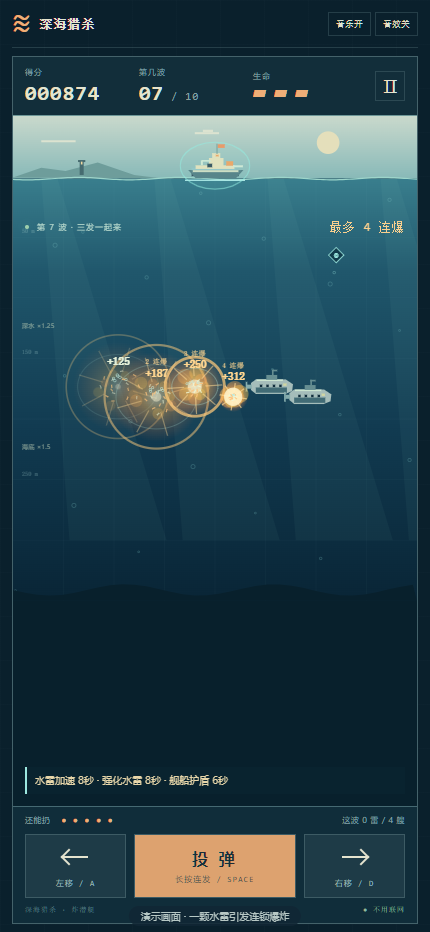
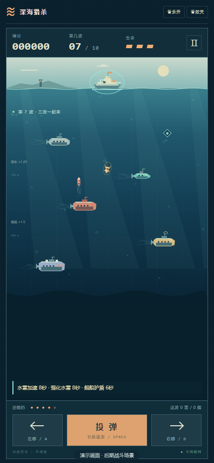
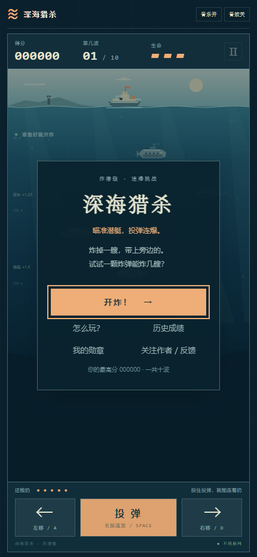
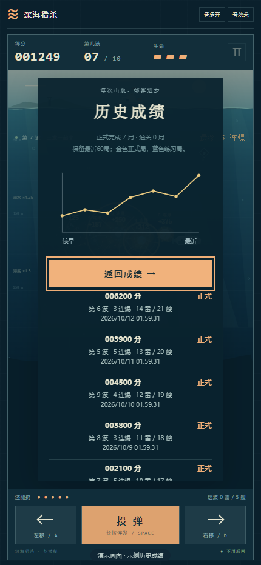
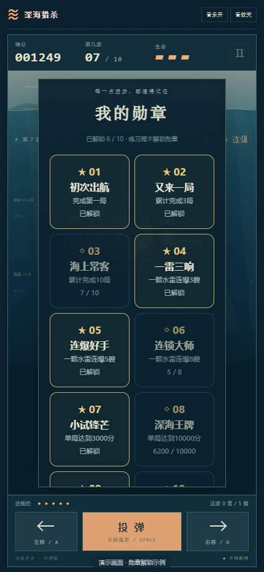
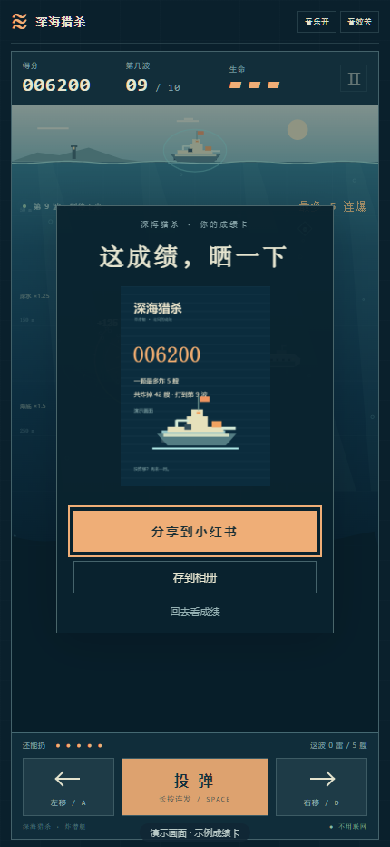

# 我把炸潜艇做成了一款小游戏

有一种快乐很简单：看准时机扔下一颗水雷，等它慢慢沉下去，先炸掉一艘潜艇，再把旁边几艘一起带走。

第一声爆炸的时候，你以为结束了。结果隔壁又亮了一下，分数继续往上跳。那一刻，手已经准备去按下一颗了。

我把这种快乐做成了《深海猎杀》：一款控制水面舰船、投下水雷、追求连环爆炸的小游戏。不用先看一大段规则，左右移动，按住投弹，就能开始。

*演示画面：使用本作实际渲染器构造的连爆场景。图中分数不是玩家排行榜成绩。*

## 看起来是投弹，玩起来是预判

水雷不会瞬间打中目标。它要穿过海水，潜艇也不会停下来等你。扔早了，可能落在艇尾；扔晚了，目标已经开走。

所以，别只盯着潜艇现在在哪里，也要想想水雷沉到那个深度时，它会开到哪里。

有时最好的机会，恰好是几艘潜艇挤到一起的那一小会儿。一颗水雷引爆第一艘，爆炸再碰到第二艘、第三艘，分数就会跟着这一串连锁往上走。我想做的，就是让这一下“看准了”的感觉足够爽。

水雷下沉时会轻轻摇晃，鱼雷带着推进水流和气泡往上冲，潜艇身后也有缓缓散开的水下尾迹。它们是帮助你看清战场的小细节，也是这片海应该有的样子。

*演示画面：后期敌人与限时能力组合展示，正常游玩需要击沉敌人、接住补给后获得能力。*

## 炸得多很好，炸得巧更值

不同潜艇的分值不同。同一种潜艇，在更深的位置被击沉，分数也会更高：你要花更多时间预判水雷的落点，命中了就应该更值得。

每一波结束，游戏还会算一笔账：用了多少颗雷，炸掉多少艘潜艇？

平均每颗雷炸到至少一艘，就有机会拿到额外奖励；如果能做到一雷两艘、一雷三艘，奖励会继续提高。奖励按这一波的击沉得分计算，完成这一波才结算。它鼓励你抓住机会，而不只是一直按着投弹。

当然，谁也不用每一颗都算得特别精确。第一局先玩明白，第二局再试试能不能比刚才少扔几颗。

## 前五波熟悉手感，后五波认真迎战

目前一共十波。前五波先让你熟悉移动、下沉时间和连爆，后五波开始逐步增加新的敌人和攻击方式。

有些潜艇会发射直线鱼雷，有些鱼雷会追着舰船的移动方向调整，还有潜艇会一次打出多枚鱼雷。看着水下的机会，也得留意水面舰船能不能躲开。

从第六波起，击沉潜艇还有机会掉落补给。补给会向水面浮起来，需要开船去接：水雷加速、强化水雷、舰船护盾，分别给你不同的应对办法。

这些能力都有时限，不是拿到一次就永久无敌。该抢机会时打一波，该保住舰船时就先躲一下。三条生命，够你犯几次错，也会让后面的每一个选择更有分量。

## 不用为了看后面的关卡，每次都从头再来

玩到一半有事离开，是很正常的事。所以我加了自动存档，也保留了暂停页里的“保存进度”。

下次在同一设备、同一存储环境打开，可以从首页继续上次，也可以重新开始。继续时会先停在暂停状态，等你准备好再走，不会刚回来就被鱼雷打个措手不及。

存下来的不只是哪一波，还包括当前分数、剩余生命和战场进度。这里使用的是本机存档，不是云同步；换设备或清理应用数据，记录可能不会跟过去。

*实际首页。已有存档时，同一位置会出现“继续上次”入口。*

## 也给自己留一点看得见的进步

我很喜欢一种感觉：今天不一定打到最高分，但回头看，会发现自己越来越会玩了。

所以，游戏里可以看最近六十局的成绩曲线，也有根据完成局数、连爆、分数和通关进度解锁的勋章。第一次完成一局、第一次一雷三响、第一次进入第六波，都有自己的小纪念。

*演示画面：分数曲线与历史列表使用示例数据，正常游玩按本机已完成对局记录。*

*演示画面：部分勋章已解锁的示例状态。*

游戏结束后还可以生成一张成绩卡。想晒的时候，再自己选择分享；这局没打好，也完全可以安静地重开一局。

*演示画面：成绩卡中的分数为展示用示例。分享和保存需客户端支持，并由你主动操作。*

背景音乐也重新做了：开场慢一点，战斗起来有旋律和节奏，后半程再增加层次。音乐、音效都能分别开关；想安静玩就关掉，手机吃力可以试试低特效。

## 如果你愿意，来帮我试一片海

审核通过并挂载后，点笔记里的《深海猎杀》小工具就能开玩。

先给你一个挑战：一颗水雷，你最多能连炸几艘？

玩完欢迎在评论里告诉我，你打到第几波，哪种潜艇最难躲。遇到问题也可以留言或私信，带上手机型号、系统版本和发生在哪一波，会更容易找到原因。

这会是我继续更新的起点。喜欢这种简单、需要一点预判、又能炸出一串连锁的小游戏，可以关注我，下一次更新再一起下海。

#深海猎杀 #小游戏 #炸潜艇 #怀旧游戏 #独立开发 #游戏推荐
